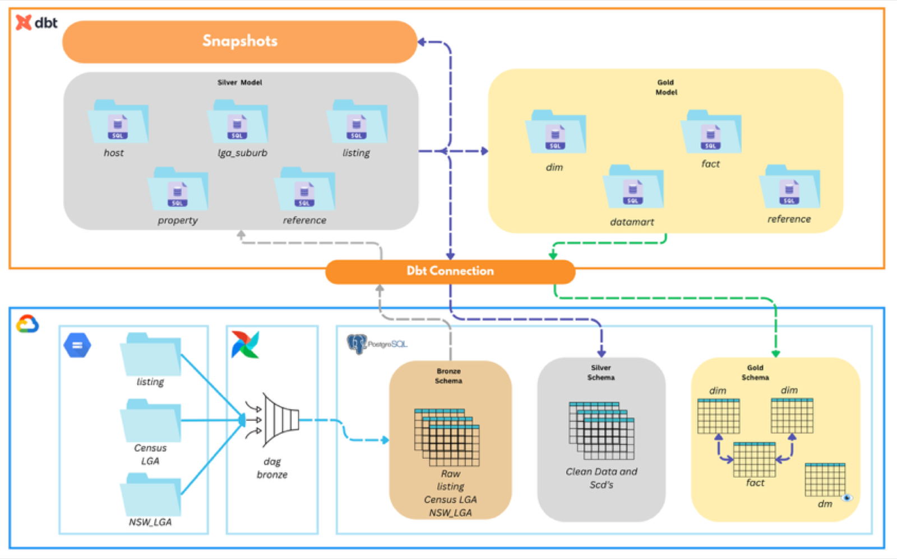
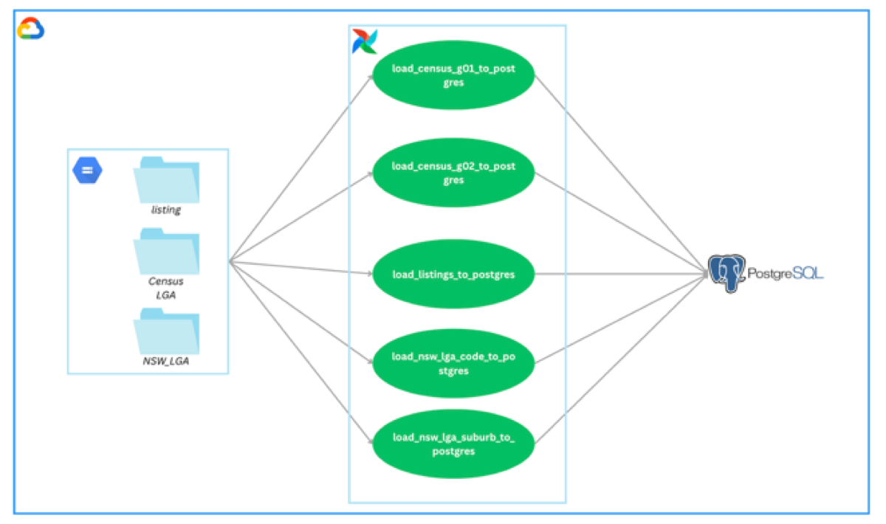
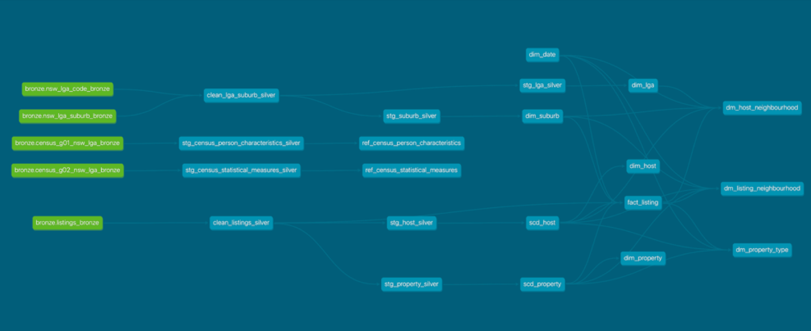
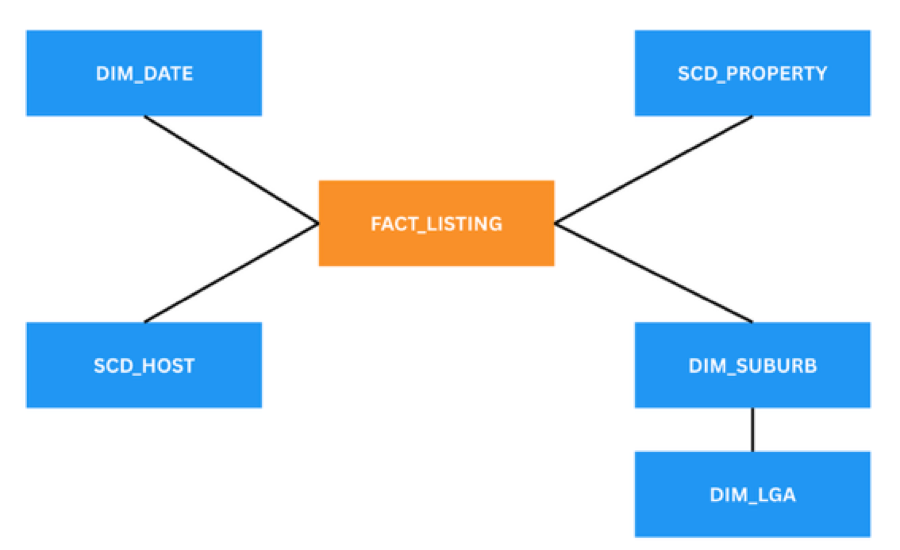
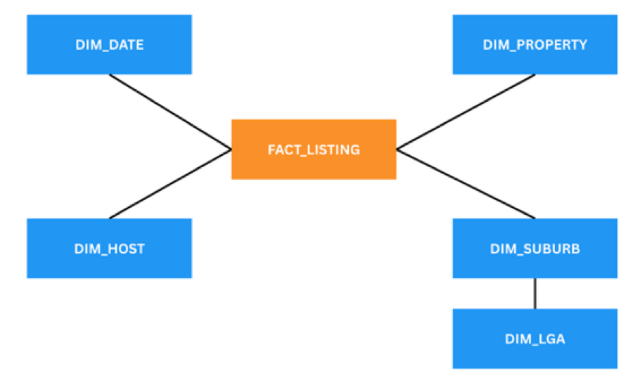
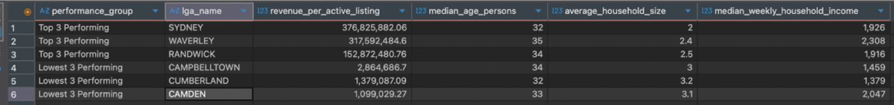
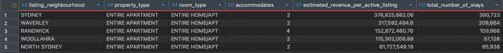
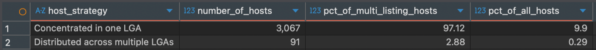
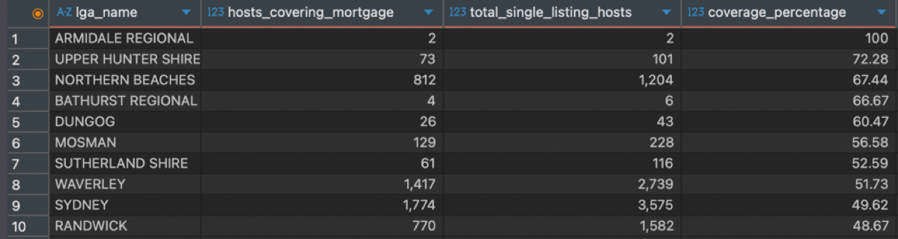

# Sydney Airbnb: Production ELT Pipeline with Airflow, dbt and PostgreSQL

A **Medallion-architecture ELT pipeline** that joins a year of monthly Airbnb listing snapshots for Sydney with 2016 Census demographics. **Apache Airflow** on Google Cloud loads raw files from Cloud Storage into **PostgreSQL**; **dbt** cleans them, tracks history with **Type 2 slowly changing dimensions**, builds a **star schema** and serves data marts that answer five questions about Sydney's short-term rental market.



## The data

| Source | Files | Role |
|---|---|---|
| [Inside Airbnb](http://insideairbnb.com/get-the-data/) | `05_2020.csv` to `04_2021.csv`, one per month | Listings: property, host, price, availability and review scores |
| [ABS Census 2016](https://www.abs.gov.au/census/find-census-data/datapacks) | `2016Census_G01_NSW_LGA.csv`, `2016Census_G02_NSW_LGA.csv` | Population by age and sex; medians for age, income, rent and mortgage per LGA |
| NSW geography | `NSW_LGA_CODE.csv`, `NSW_LGA_SUBURB.csv` | Suburb to Local Government Area (LGA) mapping |

## Pipeline

### Bronze: Airflow

[`airflow/dags/dag_bronze.py`](airflow/dags/dag_bronze.py) defines five tasks that read CSVs from the GCS-backed data folder and load them into the `bronze` schema. Census and lookup tables use a replace strategy. Listings use a **merge strategy keyed on `LISTING_ID` and `SCRAPED_DATE`**: the loader creates the table from the DataFrame dtypes on first run, then upserts through a temporary table and `ON CONFLICT ... DO UPDATE`, filtering each file to its own month so the pipeline can be re-run month by month.



### Silver and Gold: dbt



| Layer | Models | Materialisation |
|---|---|---|
| Silver clean | `clean_listings_silver`, `stg_host_silver`, `stg_property_silver` | Incremental: only rows newer than the last `scraped_date` are processed |
| Silver reference | `clean_lga_suburb_silver`, `stg_lga_silver`, `stg_suburb_silver`, `stg_census_*_silver` | Table |
| Silver history | `scd_host`, `scd_property` | dbt snapshots, timestamp strategy on `scraped_date` |
| Gold dimensions | `dim_date`, `dim_host`, `dim_property`, `dim_lga`, `dim_suburb` | Table |
| Gold reference | `ref_census_person_characteristics`, `ref_census_statistical_measures` | Table |
| Gold fact | `fact_listing` | Table |
| Gold data marts | `dm_listing_neighbourhood`, `dm_host_neighbourhood`, `dm_property_type` | View |

A custom macro, [`get_unique_versions`](dbt/macros/get_unique_versions.sql), hashes the tracked columns and keeps only rows whose hash differs from the previous version of the same key, so staging tables carry one row per real change rather than one per monthly snapshot.

### Star schema

The fact table joins to two families of dimensions. **SCD tables** give point-in-time analysis: each fact row is matched to the host and property version valid on its `scraped_date`. **Dim tables** give the current state.

<p>
  
  
</p>

After the first month was loaded, the full pipeline was run for each following month through April 2021.

## Findings

Queries are in [`sql/04_business_questions.sql`](sql/04_business_questions.sql). Revenue per active listing is estimated as `(30 - availability_30) * price`.

**1. How do the top 3 and bottom 3 LGAs by revenue differ demographically?**



Sydney, Waverley and Randwick lead with $153M to $377M; Campbelltown, Cumberland and Camden trail with $1M to $3M. Location near the CBD and the beaches drives revenue, and the top areas have smaller households (2.0 to 2.5 people) and higher incomes, typical of transient, professional, tourist-heavy zones.

**2. Does median age correlate with revenue per active listing?**

Yes. The Pearson correlation between an LGA's median age and its revenue per active listing is **0.72**, a strong positive relationship.

**3. What listing type performs best in the top 5 neighbourhoods?**



An **entire apartment for two guests** in every top LGA except Randwick, where listings for four guests get the most stays.

**4. Do multi-listing hosts concentrate in one LGA?**



**97.12%** of hosts with several listings keep them all in a single LGA. Hosts spread across LGAs are 2.88% of multi-listers and 0.29% of all hosts: the typical multi-lister is a local operator, not a geographically diverse business.

**5. Can a single-listing host cover the LGA's median mortgage from Airbnb revenue?**



Rarely. Armidale Regional shows 100% but with only two hosts. Among larger LGAs, Northern Beaches reaches 67% and Waverley 52%. Even in premium locations, Airbnb income alone usually does not cover the annualised median mortgage.

## Repository layout

```
airflow/dags/dag_bronze.py     Bronze load DAG
airflow/requirements.txt       Extra providers for the Airflow environment
dbt/                           dbt project: models, snapshots, macros, sources
sql/01_bronze_ddl.sql          Schemas and Bronze DDL
sql/04_business_questions.sql  The five analytical queries
docs/images/                   Diagrams and result tables
report/                        Full project report (PDF)
```

## Running it

1. Create a PostgreSQL instance and run `sql/01_bronze_ddl.sql`.
2. Deploy `airflow/dags/dag_bronze.py` to an Airflow environment with a `postgres` connection; place the source CSVs under the Airflow data folder in `listings/`, `Census LGA/` and `NSW_LGA/`.
3. Trigger the DAG for the first listings file, then from `dbt/` run `dbt snapshot` and `dbt run`.
4. Repeat step 3 for each monthly file, changing the listings file name in the DAG.
5. Run `sql/04_business_questions.sql` against the `gold` schema.

## Report

The full write-up with data dictionaries and model descriptions is in [`report/sydney_airbnb_pipeline_report.pdf`](report/sydney_airbnb_pipeline_report.pdf).

## Stack

Apache Airflow · Google Cloud Storage · PostgreSQL · dbt · SQL
